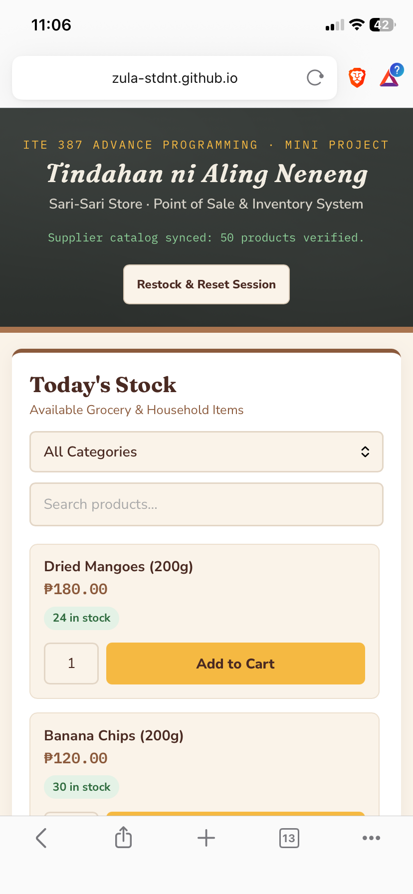
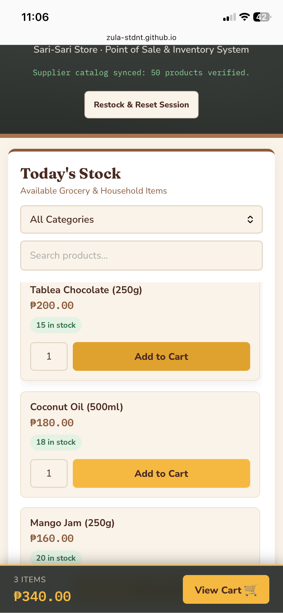
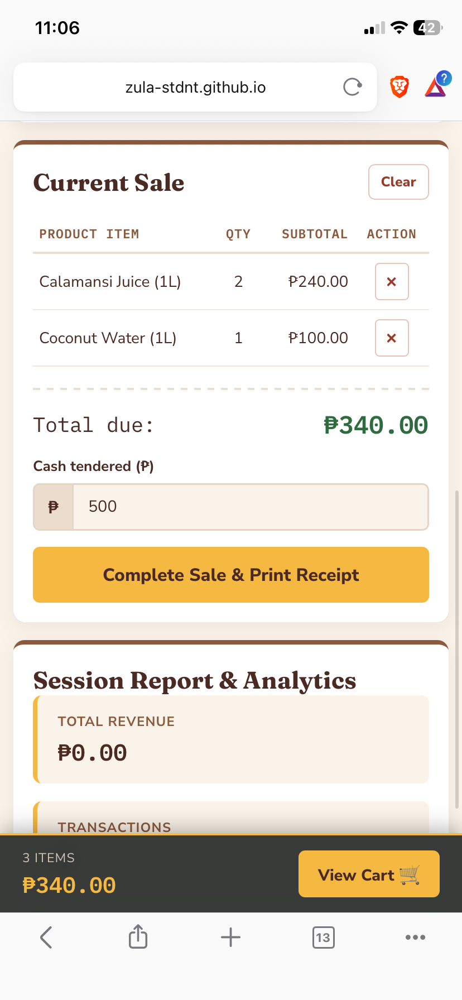
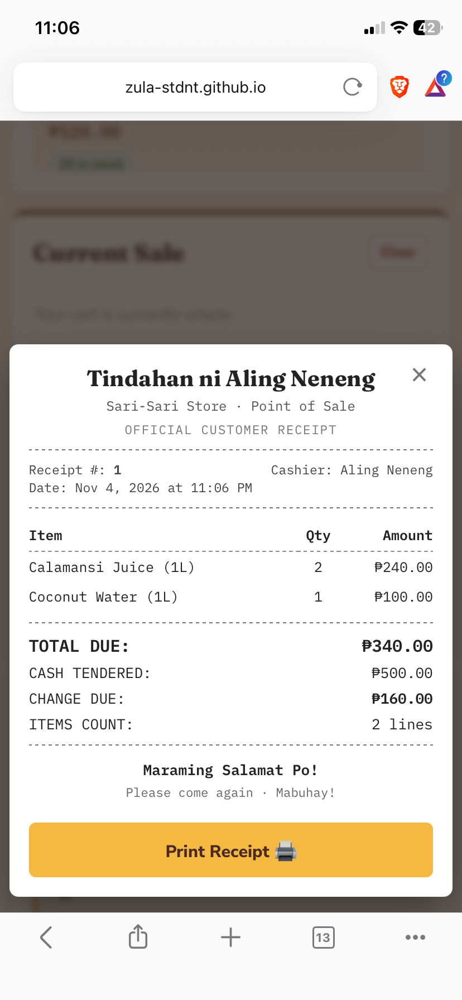
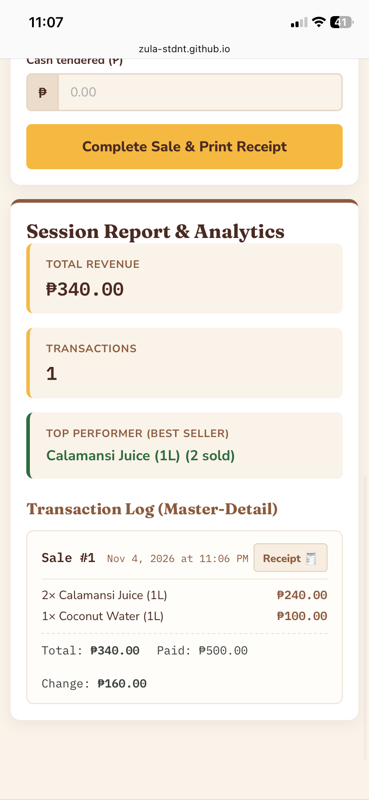

# Tindahan ni Aling Neneng — Sari-Sari Store POS 🏪


An academic **Point of Sale (POS) and Inventory Management System** built for neighborhood grocery and sari-sari stores. Developed as a **Mini Project** for **ITE 387 Advance Programming** (3rd Year, 1st Semester).

> 🌐 **Live Web Application Deployment:**  
> **[https://zula-stdnt.github.io/sarisari-store-pos/](https://zula-stdnt.github.io/sarisari-store-pos/)**  
> *Click the link above to test the live interactive POS system hosted on GitHub Pages.*

---

## 📸 User Interface Showcase

### 🖥️ Desktop Experience

| 1. Product Catalog & Category Filter | 2. Current Sale (Shopping Cart) |
| :---: | :---: |
| .png) | .png) |
| *50-item catalog with live search & category filter dropdown* | *Active cart with automatic subtotal calculation & line removal* |

| 3. Cashier Payment & Thermal Receipt | 4. Session Report & Master-Detail Log |
| :---: | :---: |
| .png) | .png) |
| *Cash payment validation, change calculation, and printable thermal receipt* | *Real-time sales revenue, transaction counter, and best-seller analytics* |

---

### 📱 Mobile-First Experience

| Mobile Store Header & Filters | 1-Column Responsive Cards | Sticky Floating Cart Bar |
| :---: | :---: | :---: |
|  |  |  |
| *Signboard with live supplier sync* | *Touch-friendly product cards* | *Real-time cart bar with 'View Cart' shortcut* |

| Mobile Checkout & Cash Tender | Mobile Thermal Receipt |
| :---: | :---: |
|  |  |
| *Clean numerical inputs & tender validation* | *Responsive customer receipt dialog with print support* |

---

## 📖 Project Overview

**Tindahan ni Aling Neneng POS** bridges traditional Filipino neighborhood retail workflows with modern client-side web engineering. It provides cashiers and store owners with a high-performance, mobile-responsive point-of-sale interface featuring real-time stock validation, Master-Detail transaction logging, thermal-style customer receipts, and persistent session analytics.

```text
 _______________________________________________________________________________
|                                                                               |
|                      TINDAHAN NI ALING NENENG — POS                           |
|        [Search Products...] [Category: All]  |   CURRENT SALE (Cart)          |
| -------------------------------------------- | ------------------------------ |
|  [Dried Mangoes 200g] ₱180  | [24 in stock]  |  1x Dried Mangoes   ₱180.00    |
|  [Banana Chips 200g]  ₱120  | [30 in stock]  |  2x Pandesal Pack   ₱160.00    |
|  [Tablea Choc 250g]   ₱200  | [15 in stock]  | ------------------------------ |
|  [Coconut Water 1L]   ₱100  | [24 in stock]  |  Total Due:         ₱340.00    |
|                                              |  Amount Paid:       ₱500.00    |
|                                              |  Change:            ₱160.00    |
|                                              |  [ Complete Sale & Receipt 🧾] |
|______________________________________________|________________________________|
```

---

## 🎓 Academic Foundations & Coding Principles (ITE 387)

This project strictly adheres to software development rules and design patterns codified in the **ITE 387 Advance Programming** curriculum:

| Rule / Principle | Source Reference | Concrete Architectural Implementation |
| :--- | :--- | :--- |
| **`RULE-JS-OBJ-01` Factory Functions** | `javascript_objects_and_arrays.md` | Prohibits raw object literals for recurring schemas; enforces clean factory functions (`createProduct`, `createCartItem`, `createTransactionHeader`, `createTransactionDetail`). |
| **`RULE-JS-OBJ-02` Property Grammar** | `javascript_objects_and_arrays.md` | Uses strict Dot Notation (`product.product_price`, `header.total_amount`) for static keys; Bracket Notation is reserved only for dynamic dictionary lookups. |
| **`RULE-JS-OBJ-03` Declarative Primacy** | `javascript_objects_and_arrays.md` | Imperative `for` loops are strictly banned for querying/aggregations. Uses declarative `.filter()` for search and categories, `.reduce()` for financial totals, and `.find()` for lookups. |
| **`RULE-JS-OBJ-04` Side-Effect Boundary** | `javascript_objects_and_arrays.md` | Restricts `.forEach()` strictly to DOM rendering side-effects, keeping functional data transformations pure. |
| **`RULE-JS-OBJ-05` Display-Reference Decoupling** | `javascript_objects_and_arrays.md` | Dropdowns and UI components strictly decouple human labels (`.innerText`) from unique system primary keys (`.value`). |
| **`Master-Detail Pattern` (Header-Detail)** | `header_detail_forms.md` | Transactions follow relational schema design: a **Master Header** (sale metadata, total, cashier, change) and an array of **Transaction Details** (line items with product ID, unit price, quantity, line total). |
| **`Client-side Persistence`** | `javascript_fundamentals.md` | Stores inventory stock adjustments and transaction history in `localStorage`, paired with a dedicated "Restock & Reset Session" utility. |
| **`Mobile First & Dynamic Styling`** | `dom_apply_styles.md` | Touch targets calibrated to $\ge 44\text{px}$, responsive 1-to-2 column product grid, and dynamic badge state classes (`stock-ok`, `stock-low`, `stock-out`). |
| **`Universal Zero-CORS Loading`** | Browser Security Standards | Runs seamlessly on direct double-click (`file:///`) via `js/app.bundle.js` with zero CORS blocking, while preserving modular source files in `js/` for academic grading. |

---

## 🌟 Key Application Features

### 🛒 Point of Sale & Inventory
- **50-Item Grocery Catalog:** Pre-populated with popular Filipino grocery items across 6 categories (*Snacks*, *Beverages*, *Pantry*, *Grains*, *Produce*, *Native Delicacies*).
- **Dual-Mode Filtering:** Real-time text search combined with the canonical Category filter dropdown.
- **Stock Depletion & Low-Stock Alerts:** Real-time stock counts. Items with $\le 5$ units trigger a visual warning badge; out-of-stock items are automatically disabled.

### 📱 Mobile UI/UX & Responsive Experience
- **Mobile Floating Cart Bar:** On mobile screens ($\le 768\text{px}$), an anchored bottom floating bar displays real-time item counts and totals with a quick "View Cart" shortcut that smoothly scrolls to the cart.
- **Split-Screen Resilience:** Flexbox filter controls wrap gracefully when running side-by-side with code editors or split windows.
- **Accessible Touch Targets:** Buttons and inputs follow minimum $44\text{px}$ touch hitbox standards.

### 🧾 Master-Detail Transactions & Printable Receipt
- **Thermal Receipt Modal:** Completing a sale triggers a thermal-paper-style receipt popup showing cashier name, transaction number, timestamp, itemized details, and change computation.
- **Dedicated Print Stylesheet (`@media print`):** Clicking **"Print Receipt"** prints only the thermal receipt cleanly to physical printers or PDF without page UI chrome.
- **Historical Receipts:** Any past transaction can be reopened and printed from the session log.

### 📊 Real-Time Analytics & Persistence
- **Live Sales Dashboard:** Tracks session revenue, total completed sales, and automatically computes the best-selling product(s).
- **Web Storage Integration:** Preserves inventory counts and sales across page reloads. A **"Restock & Reset Session"** button provides clean resets for grading demonstrations.

---

## 📂 Project Directory Structure

```text
7-27 sarisari store website/
├── index.html                      # Semantic HTML5 layout, panels, and receipt modal
├── style.css                       # Responsive stylesheet, chalkboard theme, print media rules
├── data/
│   └── products.json               # External supplier catalog JSON dataset
├── Desktop_WebPage_Screenshots/    # High-resolution desktop UI screenshots (1080p)
│   ├── Screenshot (1327).png       # Product catalog & filters
│   ├── Screenshot (1328).png       # Active shopping cart & pricing
│   ├── Screenshot (1329).png       # Payment tender & receipt modal
│   └── Screenshot (1330).png       # Session analytics & transaction log
├── Mobile_WebPage_Screenshots/     # Mobile phone UI screenshots
│   ├── IMG_1944.PNG                # Mobile store header & filters
│   ├── IMG_1945.PNG                # Mobile catalog cards
│   ├── IMG_1946.PNG                # Sticky mobile floating cart bar
│   ├── IMG_1947.PNG                # Mobile checkout & tender entry
│   └── IMG_1948.PNG                # Mobile receipt modal & log
├── js/
│   ├── app.bundle.js               # Universal browser bundle (runs with zero CORS on file:/// and localhost)
│   ├── api.js                      # Modular Axios API communication (supplier catalog sync)
│   ├── dom.js                      # Modular DOM rendering utilities & receipt generator
│   ├── main.js                     # Modular application orchestrator and event handlers
│   ├── products.js                 # Modular product catalog, factory functions, stock logic
│   ├── transactions.js             # Modular Master-Detail model, checkout, sales analytics
│   └── utils.js                    # Formatting helpers (formatPeso, formatDate) & storage
├── .gitignore                      # Git exclusion rules (.vscode, .kilocode, system files)
└── README.md                       # Portfolio-grade academic documentation
```

---

## 🚀 Quick Start Guide

This application can be accessed and run through any of the methods below:

### Method 1: Live Demo on GitHub Pages (Recommended)
Visit the live hosted deployment anytime at:  
👉 **[https://zula-stdnt.github.io/sarisari-store-pos/](https://zula-stdnt.github.io/sarisari-store-pos/)**

### Method 2: Instant Local Run (Zero Setup)
Simply navigate to the project folder and double-click `index.html` to open it directly in Google Chrome, Microsoft Edge, or Firefox.
> The universal bundle [`js/app.bundle.js`](file:///c:/xampp/htdocs/3rd%20Year/1ST%20SEMESTER/ITE%20387%20Advance%20Programming/7-27%20sarisari%20store%20website/js/app.bundle.js) guarantees instant execution over `file:///` without CORS policy errors.

### Method 3: Running via XAMPP (Apache)
1. Place this project folder inside your XAMPP web root directory:
   ```text
   C:\xampp\htdocs\
   ```
2. Open the **XAMPP Control Panel** and click **Start** on **Apache**.
3. In your web browser, navigate to:
   ```text
   http://localhost/3rd%20Year/1ST%20SEMESTER/ITE%20387%20Advance%20Programming/7-27%20sarisari%20store%20website/
   ```

### Method 4: Running via VS Code Live Server
1. Open this folder in **Visual Studio Code**.
2. Install the **Live Server** extension (by Ritwick Dey).
3. Right-click `index.html` and select **"Open with Live Server"**.

---

## 👤 Author & Academic Information

- **Student Author:** Zuriel Anthony Villaluna
- **Degree Program:** Bachelor of Science in Information Technology (BSIT)
- **Course:** ITE 387 Advance Programming (3rd Year, 1st Semester)
- **Assignment:** Mini Project — Sari-Sari Store Point of Sale Web Application
- **Live Deployment:** [https://zula-stdnt.github.io/sarisari-store-pos/](https://zula-stdnt.github.io/sarisari-store-pos/)
- **Repository:** [https://github.com/Zula-stdnt/sarisari-store-pos](https://github.com/Zula-stdnt/sarisari-store-pos)
